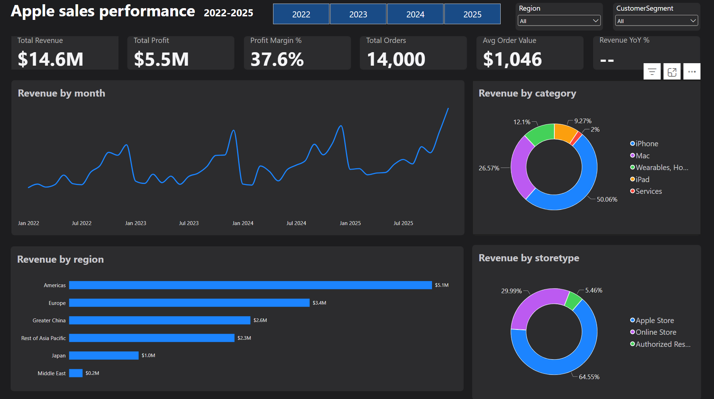
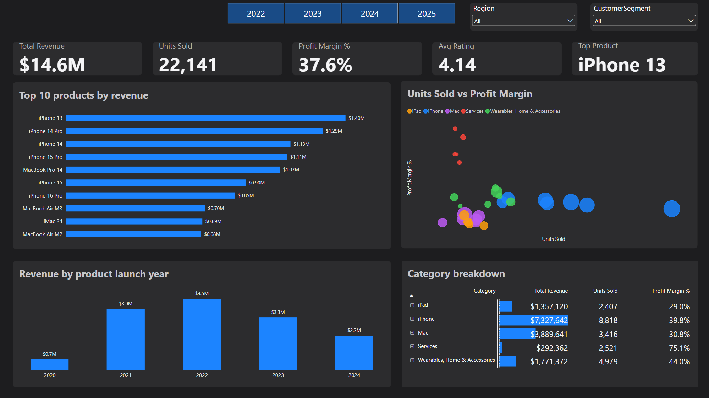
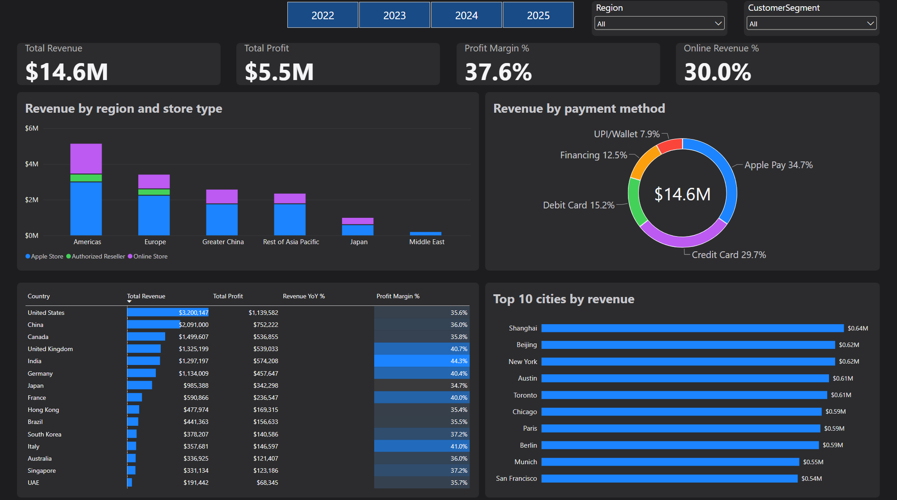
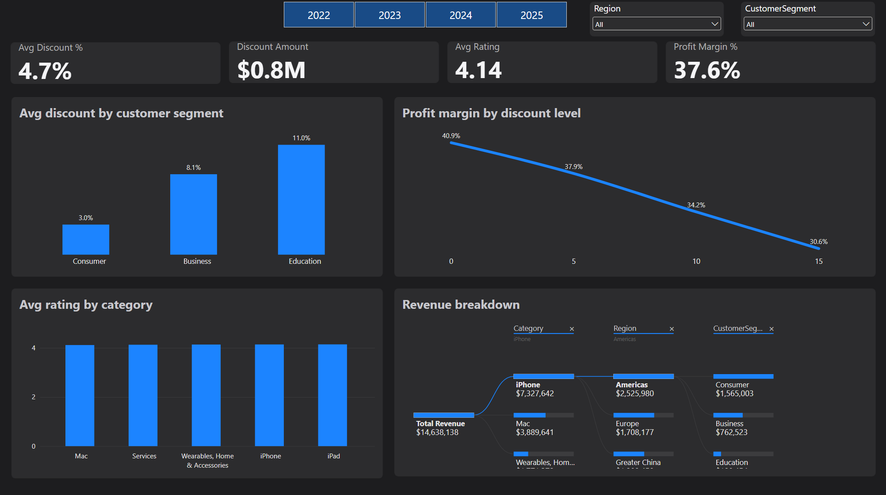

# Apple Sales Performance Dashboard (Power BI)

A **Data Analyst / Business Intelligence (BI) Analyst** portfolio project: an interactive 4-page Power BI dashboard analysing **14,000 sales transactions** across **6 regions, 28 stores and 29 products** (2022–2025). It tracks revenue, profit, growth, regional and channel performance, and the effect of discounts on margin.

> **Data note:** The dataset is **synthetic**, created for practice. It is modelled on Apple's product lines (iPhone, Mac, iPad, Wearables, Services) and seasonality (September iPhone launches, November–December peak). It is **not real Apple financial data**.



---

## Business Problem

A regional sales head wants to understand:

1. Which product categories and products drive revenue and profit?
2. Which regions and sales channels (Apple Store, Online Store, Authorized Reseller) perform best?
3. How do sales change by month, quarter and year?
4. Do discounts hurt profit margin, and which customer segments receive them?

## Key Results (at a glance)

| Metric | Value |
|---|---|
| Total revenue | $14.6M |
| Total profit | $5.5M |
| Profit margin | 37.6% |
| Total orders | 14,000 |
| Units sold | 22,141 |
| Average order value | $1,046 |
| Online store share of revenue | 30.0% |
| Average discount | 4.7% |
| Average customer rating | 4.14 / 5 |

See [Insights_and_Recommendations.md](Insights_and_Recommendations.md) for the full analysis.

---

## Tools & Skills Used

- **Data analysis** – data cleaning, exploratory analysis, KPI design, finding and presenting insights
- **Power BI Desktop** – data modelling, report design, theming
- **Power Query** – data cleaning and type transformations
- **DAX** – 15+ measures (time intelligence, ratios, conditional logic)
- **Excel / CSV** – source data
- **Data modelling** – star schema with one fact table and three dimension tables

---

## Dataset

| File | Rows | Description |
|---|---|---|
| `fact_sales.csv` | 14,000 | Orders: date, product, store, segment, quantity, unit price, unit cost, discount %, payment method, rating |
| `dim_product.csv` | 29 | Product name, category, launch date, price, cost |
| `dim_store.csv` | 28 | Country, region, city, store type |
| `dim_date.csv` | 1,461 | Calendar table (2022–2025) |
| `Apple_Sales_Dataset.xlsx` | – | All four tables as Excel sheets |

### Data model (star schema)

```
dim_product (ProductID) ──┐
dim_store   (StoreID)   ──┼──< fact_sales >── dim_date (Date = OrderDate)
```

All relationships are one-to-many, single direction (dimension to fact). The date table is marked as a date table.

---

## Dashboard Pages

### 1. Overview
KPI cards (revenue, profit, margin, orders, average order value, YoY growth), monthly revenue trend, revenue by category (donut), revenue by store type (donut), revenue by region, and Year / Region / Segment slicers.


### 2. Product Analysis
Top 10 products by revenue, units sold vs profit margin scatter chart, category breakdown matrix with data bars, and revenue by product launch year.



### 3. Regional & Channel Performance
Revenue by region and store type (stacked column), revenue by payment method (donut), top 10 cities, country performance table with conditional formatting, and online revenue share.



### 4. Discount & Customer Insights
Average discount by customer segment, profit margin by discount level, average rating by category, and a decomposition tree (category → region → segment).



---

## Key DAX Measures

```DAX
Total Revenue = SUMX(Sales, Sales[Quantity] * Sales[UnitPrice] * (1 - Sales[DiscountPct] / 100))

Total Cost = SUMX(Sales, Sales[Quantity] * Sales[UnitCost])

Total Profit = [Total Revenue] - [Total Cost]

Profit Margin % = DIVIDE([Total Profit], [Total Revenue])

Avg Order Value = DIVIDE([Total Revenue], [Total Orders])

Revenue LY = CALCULATE([Total Revenue], SAMEPERIODLASTYEAR('Date'[Date]))

Revenue YoY % =
IF(
    HASONEVALUE('Date'[Year]),
    DIVIDE([Total Revenue] - [Revenue LY], [Revenue LY])
)

Revenue YTD = TOTALYTD([Total Revenue], 'Date'[Date])

Online Revenue % =
DIVIDE(CALCULATE([Total Revenue], Store[StoreType] = "Online Store"), [Total Revenue])

Discount Amount = SUMX(Sales, Sales[Quantity] * Sales[UnitPrice] * Sales[DiscountPct] / 100)

Top Product =
VAR t = TOPN(1, ALL(Product[ProductName]), [Total Revenue])
RETURN CONCATENATEX(t, Product[ProductName], ", ")
```

---

## Key Insights

1. **iPhone drives half of all revenue** ($7.33M, 50.1%) with a 39.8% margin.
2. **Services has the best margin (75.1%)** but only about 2% of revenue, so it is a growth opportunity.
3. **Revenue peaks every December** and grows year over year, with a smaller bump in September from iPhone launches.
4. **Discounts reduce margin steadily**, from 40.9% at 0% discount to 30.6% at 15%.
5. **Education customers get the largest average discount (11.0%)**, then Business (8.1%) and Consumer (3.0%).
6. **Channel mix:** Apple Stores bring in 64.55% of revenue, Online Stores 29.99% and Authorized Resellers 5.46%.
7. **Customer ratings are almost identical across categories** (about 4.1), so rating is not a differentiator in this dataset.

## Recommendations

- Review Education and Business discount rules: every extra 5 points of discount costs roughly 3 points of margin.
- Grow Services attach rates (AppleCare+, iCloud+) because they carry 75% margin.
- Plan inventory and marketing around the September and November–December peaks.
- Expand online channels in regions where retail presence is thin.

---

## Project Structure

```
apple-sales-powerbi-dashboard/
├── data/
│   ├── fact_sales.csv
│   ├── dim_product.csv
│   ├── dim_store.csv
│   ├── dim_date.csv
│   └── Apple_Sales_Dataset.xlsx
├── dashboard/
│   ├── Apple_Sales_Dashboard.pbix
│   └── Apple_Dark_Theme.json
├── screenshots/
│   ├── 01_overview.png
│   ├── 02_product_analysis.png
│   ├── 03_regional_channel.png
│   └── 04_discount_customer.png
├── Insights_and_Recommendations.md
└── README.md
```

## How to Open

1. Download or clone this repository.
2. Open `dashboard/Apple_Sales_Dashboard.pbix` in **Power BI Desktop** (Windows).
3. If prompted, update the data source path: **Home → Transform data → Data source settings** and point to the `data` folder.
4. Optional: import `Apple_Dark_Theme.json` via **View → Themes → Browse for themes**.

## Limitations

- Synthetic data: patterns such as seasonality and discount effects were built into the dataset, so findings illustrate the analysis method and are not real-world conclusions.
- Revenue YoY starts in 2023 because the dataset begins in January 2022.
- Prices are in USD for all regions; no currency conversion is applied.

## Author

**Himanshu** – Aspiring Data Analyst / Business Intelligence Analyst
Email: [yadavgol954@gmail.com](mailto:yadavgol954@gmail.com)
